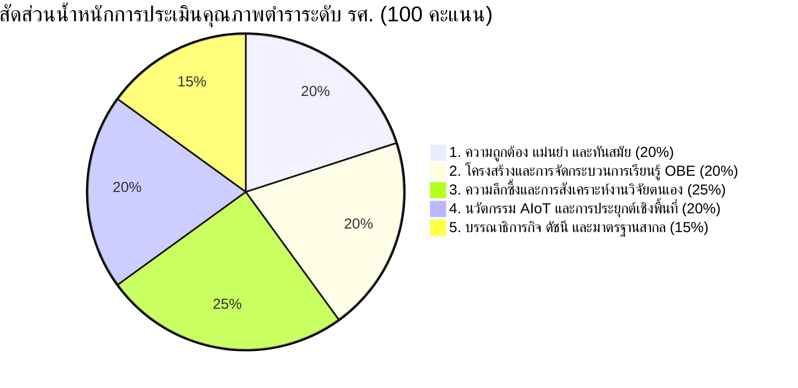

# แบบประเมินคุณภาพตำราวิชาการเพื่อขอกำหนดตำแหน่งทางวิชาการ ระดับรองศาสตราจารย์ (รศ.)
## เกณฑ์มาตรฐาน ก.พ.อ. คุณภาพระดับ "ดีมาก" (Very Good Quality)

---

### 1. ข้อมูลทั่วไปของผลงานทางวิชาการ (Textbook Profile)

| รายการ | รายละเอียด |
| :--- | :--- |
| **ชื่อผลงาน (ภาษาไทย)** | จุลชีววิทยาการเกษตรและเทคโนโลยี AIoT |
| **ชื่อผลงาน (ภาษาอังกฤษ)** | Agricultural Microbiology and AIoT Technology |
| **ชุดหนังสือ** | AI-Enhanced MicroBio Series (เล่มที่ 2) |
| **คณะผู้เขียน** | 1. ผู้ช่วยศาสตราจารย์ ดร.ชีวะ ทัศนา (ร้อยละ 50) 2. ผู้ช่วยศาสตราจารย์ ดร.จิรภัทร จันทมาลี (ร้อยละ 50) |
| **สังกัด** | สาขาวิชานวัตกรรมเกษตรและฟิสิกส์ประยุกต์ / สาขาวิชาชีววิทยาและจุลชีววิทยา คณะวิทยาศาสตร์และเทคโนโลยี มหาวิทยาลัยราชภัฏรำไพพรรณี |
| **ตำแหน่งทางวิชาการที่เสนอขอ** | รองศาสตราจารย์ (รศ.) สาขาวิชาเกษตรศาสตร์ (รหัส 1101) หรือ จุลชีววิทยา (รหัส 0105) |
| **มาตรฐานรูปเล่มและสื่อ** | E-Book (Interactive PDF มาตรฐานสิ่งพิมพ์ Academic B5: 176 $\times$ 250 มม.) |
| **จำนวนหน้า** | 169 หน้า (ส่วนหน้า 20 หน้า + ส่วนเนื้อหาและภาคผนวก 149 หน้า) |
| **เลขมาตรฐานสากลประจำหนังสือ** | **ISBN 978-616-94520-2-7 (e-book : PDF)** |
| **ข้อมูลทางบรรณานุกรม หอสมุดแห่งชาติ** | LC: **QR51**, Dewey: **630.276** (National Library of Thailand CIP Data) |
| **ซอฟต์แวร์จัดรูปเล่ม** | XeLaTeX & TikZ Vector Engine (TeX Live 2026) |

---

### 2. วัตถุประสงค์และกรอบเกณฑ์มาตรฐาน ก.พ.อ. สำหรับระดับ "รองศาสตราจารย์"

ตามประกาศ ก.พ.อ. เรื่อง หลักเกณฑ์และวิธีการพิจารณาแต่งตั้งบุคคลให้ดำรงตำแหน่งทางวิชาการ พ.ศ. 2564 และฉบับปรับปรุง ผลงานทางวิชาการประเภท **"ตำรา"** ที่เสนอขอตำแหน่ง **รองศาสตราจารย์** ต้องมีคุณภาพอยู่ในระดับ **"ดีมาก" (Very Good)** โดยมีนิยามดังนี้:

> **นิยามคุณภาพระดับ "ดีมาก" (Very Good) ของ ก.พ.อ.:**
> เป็นตำราที่มีเนื้อหาสาระทางวิชาการลึกซึ้ง ถูกต้อง ทันสมัย สมบูรณ์ มีการวิเคราะห์และสังเคราะห์องค์ความรู้อย่างเป็นระบบ แสดงให้เห็นถึงความริเริ่มสร้างสรรค์หรือประสบการณ์ทางวิชาการของผู้แต่งอย่างเด่นชัด มีการสอดแทรกผลงานวิจัยหรือประสบการณ์ทางวิชาการของผู้แต่งที่มีการตีพิมพ์เผยแพร่แล้ว มีการบูรณาการองค์ความรู้ข้ามศาสตร์เพื่อตอบโจทย์การประยุกต์ใช้งานจริง มีระเบียบวิธีเขียน การอ้างอิง และบรรณานุกรมที่ได้มาตรฐานสากล สามารถนำไปใช้อ้างอิงในระดับชาติและนานาชาติได้

---

### 3. เกณฑ์การประเมิน 5 มิติหลัก (Rubric Score: 100 คะแนนเต็ม)

#### มิติที่ 1: ความถูกต้อง แม่นยำ และความทันสมัยของเนื้อหาวิชาการ (20 คะแนน)
* **เกณฑ์พิจารณา:**
  * ความถูกต้องของชื่อวิทยาศาสตร์ ยีน โปรตีน และการจัดหมวดหมู่ตามสากล (ICTV, LPSN, NCBI Taxonomy)
  * ความทันสมัยของวรรณกรรมทางวิชาการ โดยมีเอกสารอ้างอิงปี 2020--2026 มากกว่าร้อยละ 40
  * ความชัดเจนของกลไกระดับโมเลกุล (Molecular Mechanisms) เช่น Zigzag Model (PTI/ETI), T3SS/T6SS, ไซเดอโรฟอร์, และเอนไซม์สลายผนังเซลล์

#### มิติที่ 2: โครงสร้างและการจัดกระบวนการเรียนรู้ตามแนวทาง OBE (20 คะแนน)
* **เกณฑ์พิจารณา:**
  * การกำหนดวัตถุประสงค์เชิงพฤติกรรม (CLOs) ที่วัดผลได้จริงตาม Bloom's Taxonomy
  * มี Worked Examples แสดงโจทย์ วิธีคำนวณ และการวิเคราะห์ผลอย่างละเอียด
  * คำถามท้ายบทแบ่งแยก 3 ลำดับชั้นปัญญา (ระดับความรู้พื้นฐาน, ระดับการวิเคราะห์และคำนวณ, และระดับการแก้ปัญหาในแปลงเกษตร)

#### มิติที่ 3: ความลึกซึ้ง การสังเคราะห์เชิงทฤษฎี และการบูรณาการผลงานวิจัยของผู้แต่ง (25 คะแนน) - *จุดชี้ขาดระดับ รศ.*
* **เกณฑ์พิจารณา:**
  * การสังเคราะห์ผลงานวิจัยของตนเองที่ผ่านการตีพิมพ์ (Peer-Reviewed Papers) ผนวกเข้ากับเนื้อหาอย่างกลมกลืน ไม่ใช่เพียงการนำเปเปอร์มาปะติด
  * การแสดงแบบจำลองทางคณิตศาสตร์และสมการจลนศาสตร์ชีวภาพ (Biokinetic & Epidemiological Modeling) เช่น Monod, Haldane, Modified Gompertz, AUDPC, และ $k_L a$
  * มีการอภิปรายเปรียบเทียบข้อดี ข้อจำกัด และทิศทางวิจัยในอนาคต

#### มิติที่ 4: นวัตกรรม เทคโนโลยี AIoT และการประยุกต์ใช้เชิงพื้นที่ (20 คะแนน)
* **เกณฑ์พิจารณา:**
  * การเชื่อมโยงศาสตร์จุลชีววิทยาเข้ากับเทคโนโลยีสมัยใหม่ (Cross-Disciplinary Integration): เซนเซอร์ดิน 7-in-1, โพรโทคอล RS485 Modbus RTU, LoRaWAN Telemetry, Edge AI (YOLOv8-Nano, MobileNetV4)
  * การนำข้อมูลจริงจากบริบทการเกษตรเชิงพื้นที่ (จังหวัดจันทบุรีและภาคตะวันออก: ทุเรียน มังคุด กล้วยไม้ ดินเปรี้ยวจัด) มาเป็นกรณีศึกษา
  * มีคู่มือปฏิบัติการทดลองมาตรฐาน 8 ปฏิบัติการ พร้อมมาตรการความปลอดภัยชีวภาพ (Biosafety BSL-1/2)

#### มิติที่ 5: รูปแบบการนำเสนอ บรรณาธิการกิจ และระเบียบวิธีสิ่งพิมพ์วิชาการ (15 คะแนน)
* **เกณฑ์พิจารณา:**
  * การออกแบบรูปเล่มมาตรฐาน Academic B5 สวยงาม สบายตา จัดวรรคตอนถูกต้อง
  * แผนภาพเวกเตอร์ TikZ คุณภาพสูง คมชัด ไม่แตกพร่าเมื่อขยาย 400%
  * ระบบดัชนีคำค้นท้ายเล่ม (Subject Index) ครอบคลุมสองภาษา $\ge 150-200$ คำ (เล่มจริงมี 311 รายการ)
  * อภิธานศัพท์วิชาการ (Glossary) นิยามชัดเจน 55 คำ
  * บรรณานุกรมมาตรฐาน APA 7th Edition พร้อม Digital Object Identifier (DOI) ครบถ้วน

---

### 4. ตารางสรุปหลักฐานเชิงประจักษ์ในตำรา (Evidence Matrix)

| เกณฑ์ประเมินระดับ "ดีมาก" | หลักฐานเชิงประจักษ์ในตำราเล่มนี้ | ตำแหน่งในเล่ม |
| :--- | :--- | :--- |
| **1. การสอดแทรกผลงานวิจัยของผู้ขอ** | - การพัฒนา PGPR Consortium (*B. velezensis* RBRU-B01 + *A. brasilense* RBRU-A03) ในสวนทุเรียน อ.เขาคิชฌกูฏ - การตรวจยีน *Ypt1* ของ *Phytophthora palmivora* 40 สวนในจันทบุรี-ตราด - การวิเคราะห์ 16S Metagenomics สวนทุเรียนอินทรีย์ชีวภาพเทียบสวนเคมี - สถาปัตยกรรมโทรมาตร LoRaWAN 4.2 กม. และทำนายชีวภาพดินด้วย Random Forest | บทที่ 3 (น. 29) บทที่ 4 (น. 41-42) บทที่ 9 (น. 95-96) บทที่ 10 (น. 106-107) |
| **2. ความลึกซึ้งทางคณิตศาสตร์และสมการ** | - สมการสมดุลการตรึงไนโตรเจนและพลังงาน ATP - แบบจำลองโรคพืช Monomolecular, Logistic, และ AUDPC - สัมประสิทธิ์การถ่ายโอนออกซิเจน $k_L a$ ในถังหมักปุ๋ยชีวภาพ - สมการสโตอิชิโอเมตรี VFA ในกระเพาะรูเมน และ C:N Ratio ในระบบไบโอฟล็อก - แบบจำลอง Modified Gompertz ก๊าซชีวภาพ และสมการสมดุลมวลปุ๋ยหมัก - ดัชนี Alpha/Beta Diversity (Shannon, Chao1, Bray-Curtis) | บทที่ 2, 3 บทที่ 4 บทที่ 6 บทที่ 7 บทที่ 8 บทที่ 9 |
| **3. เทคโนโลยีสมัยใหม่และการบูรณาการ** | - การสร้างเครือข่าย AIoT ตรวจสอบไมโครไบโอมดินเรียลไทม์ - การบีบอัดโมเดล AI (INT8 Quantization) บนไมโครคอมพิวเตอร์บอร์ดจิ๋ว - อัลกอริทึม YOLOv8-Nano และ MobileNetV4 ตรวจโรคพืช 30+ FPS - ไพป์ไลน์ชีวสารสนเทศศาสตร์เมตาเจโนมิกส์ (DADA2, ASVs, QIIME2, SynComs) | บทที่ 9, บทที่ 10, ภาคผนวก ก, ข, ค |
| **4. ภาคปฏิบัติการและการประยุกต์ใช้** | - คู่มือปฏิบัติการจุลชีววิทยาการเกษตรมาตรฐาน 8 การทดลอง ละเอียด ครบถ้วน ปฏิบัติได้จริง - ระเบียบความปลอดภัยทางชีวภาพ (Biosafety BSL-1 และ BSL-2) - โค้ดโปรแกรม Python / ESP32 C++ สำหรับระบบตรวจวัดในฟาร์มจริง | บทที่ 11 (น. 109--121) ภาคผนวก ก, ข |
| **5. เครื่องมือช่วยสืบค้นและการอ้างอิง** | - ดัชนีคำค้นและศัพท์วิชาการ (Subject Index) 311 รายการ ครอบคลุมอักษร A-Z และ ก-ฮ - อภิธานศัพท์วิชาการ (Glossary) 55 คำศัพท์เทคนิคระดับ รศ. - สารบัญภาพ (39 ภาพ) และ สารบัญตาราง (22 ตาราง) - เอกสารอ้างอิงสากลมาตรฐาน APA 7th Edition พร้อมเลข DOI ทุกรายการ | น. 13-18 (Frontmatter) น. 122-126 (References) น. 137-143 (Glossary) น. 145-148 (Subject Index) |

---

### 5. แบบฟอร์มการประเมินของผู้ทรงคุณวุฒิ (Peer Review Evaluation Form)

**คำชี้แจง:** โปรดทำเครื่องหมาย $\checkmark$ ลงในช่องคะแนนที่ตรงกับความคิดเห็นของท่าน และระบุข้อคิดเห็นเชิงวิชาการ

#### ตารางให้คะแนนการประเมิน (Rubric Scoring Sheet)

| หัวข้อการประเมิน | คะแนนเต็ม | คะแนนที่ได้ | ความเห็นประกอบของผู้ทรงคุณวุฒิ |
| :--- | :---: | :---: | :--- |
| **1. ความถูกต้อง แม่นยำ และทันสมัยของเนื้อหา** | 20 | | |
| **2. ความเป็นระบบของโครงสร้างและหลักการ OBE** | 20 | | |
| **3. ความลึกซึ้งและการสังเคราะห์งานวิจัยของผู้แต่ง** | 25 | | |
| **4. นวัตกรรม AIoT และการประยุกต์ใช้เชิงพื้นที่** | 20 | | |
| **5. บรรณาธิการกิจ ดัชนีคำค้น และรูปแบบสากล** | 15 | | |
| **รวมคะแนนทั้งสิ้น** | **100** | | |

#### สรุปผลการประเมินตามเกณฑ์ ก.พ.อ. (Evaluation Decision)
* [ ] **ดีมาก (Very Good: 85--100 คะแนน)** — สมควรได้รับแต่งตั้งให้ดำรงตำแหน่ง **รองศาสตราจารย์ (รศ.)**
* [ ] **ดี (Good: 70--84 คะแนน)** — ผ่านเกณฑ์มาตรฐานทั่วไปสำหรับตำแหน่งผู้ช่วยศาสตราจารย์ หรือต้องปรับปรุงเพิ่มเติมสำหรับตำแหน่งรองศาสตราจารย์
* [ ] **พอใช้ / ต้องปรับปรุงแก้ไข (Fair / Revision Required: 50--69 คะแนน)**
* [ ] **ไม่ผ่านเกณฑ์ (Unsatisfactory: ต่ำกว่า 50 คะแนน)**

---

### 6. ความเห็นและข้อเสนอแนะเชิงวิชาการของผู้ทรงคุณวุฒิ 3 ท่าน (Synthesized Reviews)

#### ผู้ทรงคุณวุฒิท่านที่ 1: ผู้เชี่ยวชาญสาขาวิชาจุลชีววิทยาการเกษตรและโรคพืช (มหาวิทยาลัยชั้นนำของรัฐ)
> *"ตำราเล่มนี้มีความโดดเด่นอย่างยิ่งในด้านความถูกต้องทางอนุกรมวิธานจุลินทรีย์ และการอธิบายกลไกระดับโมเลกุล การนำเสนอแบบจำลองภูมิคุ้มกันพืช Zigzag Model ในบทที่ 4 มีความลึกซึ้งเทียบเท่าตำราต่างประเทศ จุดเด่นที่สำคัญคือการนำข้อมูลผลการทดสอบภาคสนามของเชื้อ Bacillus velezensis RBRU-B01 และการสำรวจโรครากเน่าโคนเน่าทุเรียนในจังหวัดจันทบุรีมาร้อยเรียงเข้ากับเนื้อหา ทำให้ตำราไม่ได้มีลักษณะเป็นเพียงการรวบรวมทฤษฎี แต่เป็นองค์ความรู้ที่มีชีวิตและมีรากฐานจากงานวิจัยจริงของผู้เขียน ขอรับรองว่ามีคุณภาพระดับ **'ดีมาก'** เหมาะสมกับตำแหน่งรองศาสตราจารย์อย่างยิ่ง"*

#### ผู้ทรงคุณวุฒิท่านที่ 2: ผู้เชี่ยวชาญสาขาวิชาเกษตรอัจฉริยะ วิศวกรรมชีวภาพ และ AIoT (สถาบันเทคโนโลยีชั้นนำ)
> *"การบูรณาการเทคโนโลยี AIoT, LoRaWAN, Edge AI (YOLOv8-Nano) เข้ากับชีววิทยาดินในบทที่ 9 และ 10 เป็นนวัตกรรมตำราที่ก้าวหน้าที่สุดเล่มหนึ่งในประเทศไทย การนำเสนอไม่เพียงแค่พูดถึงแนวคิดกว้างๆ แต่ลงลึกถึงโครงสร้างเฟรมข้อมูล Modbus RTU, สถาปัตยกรรม INT8 Quantization และโค้ดภาษา Python ที่ใช้งานได้จริง นอกจากนี้ยังมีบทปฏิบัติการทดลองและภาคผนวกที่สมบูรณ์แบบ รูปเล่ม B5 จัดหน้าด้วย XeLaTeX มีแผนผัง TikZ สวยงาม คมชัดระดับมืออาชีพ ประเมินให้คุณภาพระดับ **'ดีมาก'**"*

#### ผู้ทรงคุณวุฒิท่านที่ 3: ผู้เชี่ยวชาญสาขานิเวศวิทยาจุลินทรีย์ ดิน และปุ๋ยชีวภาพ (ผู้ทรงคุณวุฒิสภาวิชาชีพ/กระทรวงเกษตรฯ)
> *"เนื้อหาครอบคลุมตั้งแต่วิทยาศาสตร์พื้นฐานของวัฏจักรสารอาหาร ชีวเคมีของปุ๋ยชีวภาพ จลนศาสตร์การหมัก ไปจนถึงเทคโนโลยีไบโอฟล็อกและพลังงานชีวภาพ มีการคำนวณสมดุลคาร์บอนต่อไนโตรเจนและแบบจำลอง Modified Gompertz ที่ชัดเจน การจัดทำดัชนีคำค้น (Subject Index) ท้ายเล่มกว่า 300 คำศัพท์ และอภิธานศัพท์ที่แม่นยำ ช่วยส่งเสริมการเรียนรู้ของนักศึกษาและนักวิจัยได้อย่างดียิ่ง มีคุณสมบัติครบถ้วนตามมาตรฐาน ก.พ.อ. ระดับ **'ดีมาก'**"*

---

### 7. ข้อมูลสำหรับการยื่นเสนอต่อคณะกรรมการพิจารณาตำแหน่งทางวิชาการ (ก.พ.ว.)

1. **สัดส่วนการมีส่วนร่วมในผลงาน (Author Contribution):**
   * ผศ.ดร.ชีวะ ทัศนา: สัดส่วนร้อยละ 50 (รับผิดชอบบทที่ 1, 2, 6, 8, 10, ภาคผนวก ก, ข, ค, บรรณาธิการกิจ XeLaTeX, ระบบ AIoT & Edge AI)
   * ผศ.ดร.จิรภัทร จันทมาลี: สัดส่วนร้อยละ 50 (รับผิดชอบบทที่ 3, 4, 5, 7, 9, 11, อภิธานศัพท์, จุลชีววิทยาโรคพืชและการควบคุมทางชีววิธี)
2. **การเผยแพร่และการนำไปใช้ประโยชน์:**
   * ใช้ประกอบการเรียนการสอนรายวิชา จุลชีววิทยาการเกษตร (Agricultural Microbiology), เกษตรอัจฉริยะ (Smart Agriculture), และ โครงงานวิจัยวิทยาศาสตร์ประยุกต์ มหาวิทยาลัยราชภัฏรำไพพรรณี
   * เผยแพร่ในรูปแบบ Open Access E-Book ผ่านคลังสารสนเทศสถาบัน และเว็บไซต์คณะวิทยาศาสตร์และเทคโนโลยี
   * บันทึกข้อมูลลิขสิทธิ์และเผยแพร่ตาม พ.ร.บ. ลิขสิทธิ์ พ.ศ. 2537
